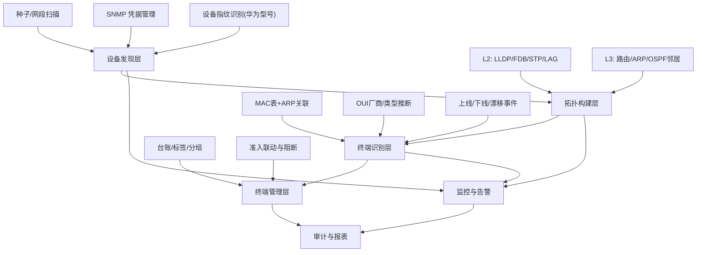
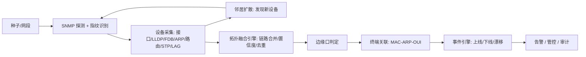

# HopTrace 产品分析方案

> 网络拓扑自动发现与终端管理系统(以华为交换机 / 防火墙为首要适配对象)
> 版本:v0.1(草案)  日期:2026-11-27

---

## 1. 背景与问题定义

企业/园区网络普遍存在以下痛点:

| 痛点 | 具体表现 |
|---|---|
| 拓扑靠人画 | Visio 图更新滞后,设备增删、链路调整后文档与现网不一致 |
| 终端“看不见” | 不知道某个 IP/MAC 接在哪台交换机的哪个端口、哪个 VLAN,故障定位靠逐台登录 `display mac-address` |
| 资产不清 | 终端归属、类型、厂商、在线状态缺少统一台账,私接设备、仿冒设备难发现 |
| 管控手段分散 | 封禁终端需登录设备手工 shutdown 端口/下 ACL,效率低且易出错 |
| 变更不可追溯 | 终端上线/下线/漂移历史缺失,安全审计和故障复盘无据可查 |

**产品定位**:一套**无 Agent、基于 SNMP(辅以 SSH/NETCONF)**的网络拓扑自动发现与终端全生命周期管理平台,实现
**“设备 → 链路 → 端口 → 终端”四层可视、可查、可管**。

## 2. 目标用户与场景

| 角色 | 核心诉求 | 典型场景 |
|---|---|---|
| 网络运维工程师 | 快速定位、拓扑准确 | 输入 IP/MAC,5 秒内定位到接入交换机+端口;链路中断时看到影响范围 |
| 网络/安全管理员 | 终端可控、可审计 | 发现未知终端告警;一键封禁/隔离;上线/下线审计 |
| IT 资产管理员 | 资产台账 | 终端自动入库,按楼层/部门/类型统计 |
| 管理层 | 全局可视 | 网络规模、健康度、终端接入概况大屏 |

### 典型用户故事

1. 作为运维,我输入一个 IP,系统返回:MAC → 接入设备 → 端口 → VLAN → 上联路径 → 网关,以及最近 30 天的位置变更。
2. 作为运维,我打开拓扑图,看到某条上联链路变红,并能看到受影响的下游设备数和终端数。
3. 作为安全员,新终端接入时我收到告警(MAC/厂商/位置),并可选择“放行 / 隔离 / 封禁”。
4. 作为资产管理员,我按交换机端口备注/位置导出终端清单。

## 3. 产品范围

### 3.1 功能全景

### 3.2 功能模块明细

#### M1 设备发现
- 发现方式:种子设备递归(通过 LLDP/ARP/路由邻居扩散)、IP 段扫描(SNMP sysObjectID 探测)、手工/CSV 导入。
- 凭据管理:SNMP v2c/v3(优先 v3,支持 authPriv)、按网段/设备分组绑定凭据、凭据加密存储、凭据自动探测。
- 设备指纹:sysObjectID 前缀 + sysDescr 正则 + ENTITY-MIB,识别华为 S 系列交换机、CE 数据中心交换机、USG/Eudemon 防火墙、AR 路由器、AC/AP 等;非华为设备走通用标准 MIB 兜底。
- 设备画像:型号、版本(VRP)、序列号、板卡/堆叠(iStack/CSS)/框式设备主备、管理 IP、位置联系人。

#### M2 拓扑构建
- **L2 物理拓扑**:LLDP 为主(IEEE LLDP-MIB),华为 NDP 与 FDB 推断为补充;识别 Eth-Trunk(链路聚合)并合并为逻辑链路,保留成员口。
- **L3 逻辑拓扑**:路由表、OSPF/BGP 邻居、网关/VLANIF 接口、防火墙安全区域(Zone)归属。
- **特殊形态**:堆叠/集群合并为逻辑设备、VRRP/HRP 双机、虚拟系统(VSYS)。
- 拓扑质量:每条链路带“置信度 + 证据来源”(LLDP 双向确认 > 单向 LLDP > FDB 推断),冲突/孤岛可视化。
- 视图:全局图、按站点/楼栋/VLAN/区域过滤、路径追踪(A→B 经过哪些设备)、手工编辑与坐标持久化、导出 PNG/SVG/Visio。

#### M3 终端识别与定位
- 数据源:接入交换机 MAC 地址表(Q-BRIDGE-MIB)、网关/核心/防火墙 ARP 表、DHCP 日志/Snooping 表(可选)。
- **边缘口判定**:端口无 LLDP 邻居、不属于链路聚合/上联、MAC 数量低于阈值 ⇒ 接入口;其上学到的 MAC 即终端。
- 终端画像:MAC、IP、VLAN、接入设备/端口、OUI 厂商、主机名(DHCP/NetBIOS/mDNS 可选)、类型(PC/IP 电话/AP/摄像头/打印机/IoT)、首次/最近在线。
- 特殊终端:IP 电话(LLDP-MED)、AP(LLDP/华为 NDP)后面的二级终端(二期)、无线终端(经 AC 的 STA 表,二期)。
- 事件:上线、下线、漂移(换端口/换交换机)、IP 变化、MAC 冲突/IP 冲突。

#### M4 终端管理
| 能力 | 说明 | 实现手段 | 阶段 |
|---|---|---|---|
| 台账 | 标签、分组、责任人、位置、备注 | 平台自有 | MVP |
| 白名单/基线 | 已知终端放行,未知终端告警 | 平台规则 | MVP |
| 端口管理 | 端口启停、描述回写、VLAN 变更 | NETCONF / SSH(只读默认关闭,需显式授权) | 二期 |
| 终端隔离/封禁 | 端口 shutdown、黑洞 MAC、ACL 下发 | NETCONF / SSH,或联动准入系统 | 二期 |
| 准入联动 | 与华为 iMaster NCE-Campus / 802.1X / MAC 认证 / RADIUS 联动 | REST API / RADIUS | 三期 |
| IP-MAC 绑定 | 生成/下发静态绑定、DAI/IPSG 配置 | NETCONF | 三期 |

> **原则**:SNMP 只用于“读”;所有“写”操作走独立的 NETCONF/SSH 通道,带审批、预览(dry-run)、回滚和审计。

#### M5 监控与告警
- 设备可用性(ICMP + SNMP)、端口状态/流量/错误包、CPU/内存/温度(华为 ENTITY-EXTENT-MIB)。
- Trap/Syslog 接收:linkUp/linkDown 触发局部增量重扫,缩短拓扑收敛延迟。
- 告警:设备离线、链路中断、新终端接入、终端漂移、MAC 漂移/环路嫌疑、端口 MAC 数异常(私接小交换机)。
- 通知:邮件、企业微信/钉钉/飞书 Webhook。

#### M6 审计与报表
终端上线历史、拓扑变更历史(链路新增/消失)、操作审计、资产/接入统计报表、拓扑快照对比(任意两个时间点 diff)。

### 3.3 非目标(首版不做)
- 不做完整的性能监控平台(流量分析、NetFlow/sFlow 作为后续扩展)。
- 不做配置备份/合规管理(可后续作为模块)。
- 不做终端 Agent(软件资产、补丁等)。
- 不替代华为 iMaster NCE,定位为轻量、开放、可跨厂商扩展的补充或独立方案。

## 4. 竞品与参照分析

| 产品 | 类型 | 优势 | 不足 / 差异空间 |
|---|---|---|---|
| 华为 iMaster NCE-Campus / eSight | 厂商官方 | 对华为设备适配最深,有完整准入/SDN 能力 | 价格高、较重;多厂商混合环境能力弱;eSight 已逐步被 NCE 替代 |
| SolarWinds NTM / ManageEngine OpManager | 商业 | 拓扑自动发现成熟 | 授权贵,国产设备适配与中文化弱,信创要求难满足 |
| Zabbix / PRTG | 通用监控 | 监控强、生态大 | 拓扑非强项,无终端定位 |
| LibreNMS / Observium | 开源 NMS | LLDP/CDP/FDP 自动发现,社区活跃 | 拓扑展示粗糙,终端管理弱 |
| **Netdisco** | 开源(Perl) | **MAC/端口定位、终端节点追踪做得最好**,可作为设计参考 | 界面老旧,无告警/管控闭环,华为适配一般 |
| NetBox / Nautobot (+ Diode/Orb) | 资产源数据库 | 数据模型规范,可做 SoT | 本身非发现系统 |
| 锐捷 SNC / H3C iMC / 国产厂商 NMS | 厂商 | 自家设备深度适配 | 跨厂商能力差 |

**差异化定位**
1. **华为深度适配**:型号指纹库、华为私有 MIB、堆叠/框式/VSYS/Eth-Trunk 特殊场景处理。
2. **终端中心**:以“终端”为一等公民(位置、历史、画像、管控),而非只关注设备。
3. **拓扑可信度**:证据链 + 置信度,而不是“画出来就算”。
4. **轻量开放**:单二进制/容器部署,REST API 与 Webhook 友好,易与资产库、工单、准入集成。

## 5. 关键业务流程

### 5.1 发现-构建-识别主流程

### 5.2 终端定位算法(核心)
1. 在**网关/核心/防火墙**读取 ARP 表,得到 `IP ↔ MAC`(多网关需合并)。
2. 在**所有交换机**读取 FDB,得到 `MAC ↔ (端口, VLAN)`。
3. 过滤 FDB 条目:剔除 CPU/管理口、**上联口(有 LLDP 邻居或属聚合/Trunk)**、本机 MAC。
4. 对同一个 MAC 出现在多台交换机的情况,取**最靠近终端侧**的那个端口(即 MAC 数最少且为边缘口的端口;或沿拓扑树自叶向根选最远端)。
5. 输出 `终端 → 接入设备/端口/VLAN`,与上一次比较生成事件。

## 6. 华为设备适配要点

| 项目 | 说明 | 风险/备注 |
|---|---|---|
| SNMP 版本 | 新版 VRP 默认可能关闭 v1/v2c,需 `snmp-agent sys-info version v3` 等配置 | 与客户协同做**纳管前置检查清单** |
| LLDP | 需全局与接口使能(`lldp enable`),部分机型默认状态不同 | 未开启时降级为 FDB 推断,置信度降低 |
| 私有协议 | 华为 NDP/NTDP 可作为补充 | 以官方 MIB 文档与实测为准 |
| 硬件监控 | HUAWEI-ENTITY-EXTENT-MIB(企业号 `1.3.6.1.4.1.2011`)提供 CPU/内存/温度/电源/风扇 | 不同产品线 OID 有差异,需 per-model 适配 |
| 堆叠/集群 | iStack/CSS 在 ENTITY-MIB 中表现为多槽位,但逻辑上为一台设备 | 需识别并合并,避免拓扑中出现“幽灵设备” |
| 防火墙 | USG 系列二层能力有限,**FDB 可能为空**,以 ARP、路由、接口 Zone 为主 | HRP 双机热备需识别主备、避免重复 |
| 虚拟系统 | VSYS 下的 SNMP 访问与上下文(context)处理 | 需实测 |
| 采集性能 | 老型号对大表 walk 敏感,CPU 可能被推高 | 采集限速、错峰、GetBulk 合理 `max-repetitions`、每设备并发=1 |
| 验证环境 | 华为 eNSP(S5700/USG6000V 等镜像)+ 真机实验室 | eNSP 的 MIB 支持不完整,必须有真机回归 |

> ⚠️ 具体 OID、sysObjectID 与版本差异必须在**真机/官方 MIB 文档**中逐项校准,本文列出的均为设计方向,不作为最终实现依据。

## 7. 非功能性需求

| 维度 | 指标(MVP 目标) |
|---|---|
| 规模 | 设备 ≤ 1,000 台,终端 ≤ 100,000 个(单站点单实例);多站点通过分布式采集器扩展 |
| 发现时效 | 全量发现 ≤ 30 分钟(500 台设备);增量(Trap 触发)≤ 60 秒 |
| 终端位置刷新 | 周期 5 分钟(可配置),重点区域可 1 分钟 |
| 拓扑准确率 | LLDP 覆盖链路准确率 ≥ 99%;含推断链路整体 ≥ 95%(需抽样验证) |
| 设备影响 | 采集期间单设备 CPU 增量 < 5%(可限速配置) |
| 可用性 | 采集器与服务端解耦,采集器无状态可重启;服务端支持 HA(二期) |
| 安全 | 凭据加密(AES-GCM + KMS/主密钥),RBAC,操作审计,HTTPS,SNMPv3 优先,写操作审批 |
| 合规 | 支持等保 2.0 审计要求;支持信创部署(麒麟/统信 + 鲲鹏/飞腾:Go 交叉编译天然友好) |

## 8. 风险与对策

| 风险 | 影响 | 对策 |
|---|---|---|
| LLDP 未使能、邻居缺失 | 拓扑不完整 | FDB 推断算法 + 置信度标注 + 纳管检查清单 |
| 采集压垮老设备 | 业务受影响 | 限速、分批、黑名单窗口、配置可观测 |
| MAC 漂移 / 环路 / 虚拟化 | 终端定位抖动 | 稳定期判定(连续 N 轮一致才变更)、漂移事件单独告警 |
| 小交换机/HUB 私接 | 一口多 MAC,误判为上联 | 以 LLDP 与 MAC 数阈值区分;标记“疑似私接” |
| 无线与 NAT 终端 | 看不全 | 二期接入 AC STA 表,标注“不可见区域” |
| 华为型号/版本差异 | 适配成本高 | 型号指纹库 + 采集模板(YAML/规则)可热更新 |
| 写操作误伤 | 业务中断 | 默认只读;写操作审批、dry-run、保护名单(核心/上联端口不可操作)、一键回滚 |
| 凭据泄露 | 安全事件 | 加密存储、最小权限只读 SNMPv3 用户、访问审计 |

## 9. 版本路线图

| 阶段 | 周期(估) | 目标 | 交付 |
|---|---|---|---|
| **M0 技术验证** | 2–3 周 | 用真机验证华为 SNMP/LLDP/FDB/ARP 采集的可行性、OID 与样本库 | 设备样本数据集、Spike 报告 |
| **M1 MVP** | 8–10 周 | 华为 S 系列+USG 发现、LLDP 拓扑、终端定位、拓扑可视化、基础告警 | 可交付给试点客户 |
| **M2 管控** | 6–8 周 | 终端台账/基线、Trap 增量、NETCONF 端口管控(审批+回滚)、报表 | 终端闭环管理 |
| **M3 扩展** | 持续 | 无线 AC 接入、准入(NCE/802.1X)联动、多站点、HA、多厂商(H3C/锐捷/思科) | 平台化 |

## 10. 成功指标(KPI)

- 拓扑自动发现覆盖率(已纳管设备 / 实际设备)≥ 95%
- 终端定位准确率(抽样验证)≥ 98%
- 平均故障定位时间(MTTR 中“定位”环节)较人工下降 ≥ 70%
- 新终端发现延迟 ≤ 一个采集周期
- 对被管设备的采集影响:无投诉/无告警触发

## 11. 待确认问题

请确认以下信息,以便细化方案:

1. **规模**:设备数、终端数量级、是否多站点/多机房?
2. **设备**:华为交换机/防火墙的具体型号与 VRP 版本分布?是否已有 iMaster NCE/eSight?
3. **终端范围**:是否包含无线终端(AC/AP)、VoIP、IoT?
4. **管控深度**:只需“看”,还是需要“封禁/隔离/改 VLAN”?是否已有准入系统(802.1X/Portal)?
5. **部署形态**:自用内部系统,还是要做成可售产品(影响多租户、授权、国产化要求)?
6. **是否允许 SSH/NETCONF**:除 SNMP 外是否有设备登录权限?
7. **有无真机实验环境**用于验证?
