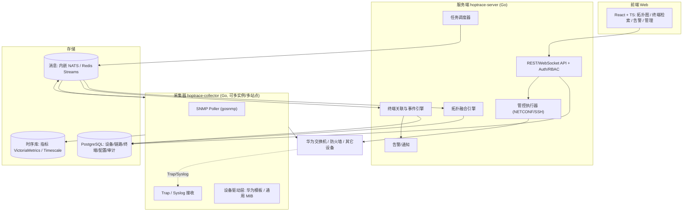
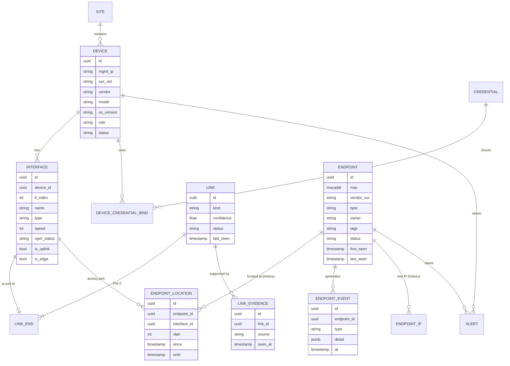

# HopTrace 技术选型分析

> 配套文档:[01-产品分析方案.md](./01-产品分析方案.md)
> 版本:v0.1(草案)  日期:2026-11-27

---

## 1. 选型原则

1. **采集可靠优先**:SNMP 采集是系统根基,要求并发可控、超时/重试精细、对设备友好。
2. **部署简单**:内网/政企场景居多,倾向单二进制 + 少量依赖,支持离线与信创环境。
3. **渐进式架构**:MVP 用最少组件(PostgreSQL 为主),规模上来再拆分,避免过度设计。
4. **可扩展**:设备适配以“规则/模板”驱动,新增型号尽量不改代码。
5. **团队匹配**:团队熟悉 **Go + Kratos + GORM + Ant Design**,据此定为主栈(2026-11-27 评审确认)。

> **变更记录(v0.2)**:后端框架确定为 **Kratos v3(service / biz / data 三层,由 kratos new 脚手架初始化)**;ORM 确定为 **GORM**(生产 PostgreSQL,开发/演示 SQLite 纯 Go 驱动);前端确定为 **Ant Design Pro 6(Umi Max + antd 6 + ProComponents,web/ 目录已初始化)**。MVP 阶段消息队列/调度全部进程内实现(NATS 作为多站点采集器阶段的演进项),FDB 推断拓扑暂列为 M1.5,不在首个可运行版本内。

## 2. 总体架构



**部署形态**
- **MVP**:单进程 `hoptrace`(server + 内嵌 collector 模式)+ PostgreSQL,Docker Compose 一键起。
- **规模化**:collector 独立部署在各站点,通过 gRPC/NATS 回传;server 水平扩展;指标走独立时序库。

## 3. 核心技术选型对比

### 3.1 后端语言

| 方案 | 优点 | 缺点 | 结论 |
|---|---|---|---|
| **Go** | 并发模型天然适合大批量设备轮询;单二进制易部署;交叉编译到 ARM64(鲲鹏/飞腾/麒麟)方便;gosnmp 成熟 | 泛型/生态略少于 Java;图算法库较少(可自写) | ✅ **推荐** |
| Python | pysnmp/netmiko/napalm 等网络自动化生态最丰富,原型快 | 高并发性能与部署(依赖、GIL)较弱;pysnmp 维护历史上有波动 | 作为**脚本/原型/MIB 探索**工具 |
| Java | SNMP4J 功能最完整,企业级生态 | 部署重、内存占用高 | 若团队主栈为 Java 再考虑 |
| Rust | 性能/安全最佳 | SNMP 库与生态不成熟,开发效率低 | 不推荐 |

### 3.2 SNMP 采集库

| 方案 | 说明 | 结论 |
|---|---|---|
| **gosnmp/gosnmp** | Go 纯实现,支持 v1/v2c/v3(MD5/SHA/SHA2、DES/AES)、`BulkWalk`、Trap Listener、可配超时重试 | ✅ **主选** |
| Net-SNMP(CLI/绑定) | 事实标准,调试利器 | 仅用于**调试对照**(`snmpwalk`),不进入生产路径 |
| SNMP4J | Java 方案首选 | 备选 |
| Telegraf / snmp_exporter | 面向指标采集,配置式 | 可借鉴其“模块化 OID 配置”思路,但**不适合拓扑关联类表的深度处理** |

**自研采集层的关键设计**
- 每设备独立限速令牌桶 + 单设备串行 walk,不同设备并行(worker pool)。
- `GetBulk` 的 `max-repetitions` 按设备型号自适应(默认 20~50),超时指数退避。
- v3 引擎 ID/时间同步缓存;凭据按设备绑定,探测成功后记忆。
- MIB 不在运行时解析,**预编译为 OID 常量 + 解码器**(用 `gosmi` 或离线脚本生成),减少依赖。
- 采集模板(YAML)描述:OID、解码方式、过滤、适用型号;**华为差异放模板,而不是代码分支**。

### 3.3 需采集的 MIB / 数据源清单

| 数据 | 标准 MIB(优先) | 华为/备注 |
|---|---|---|
| 设备基础 | SNMPv2-MIB(sysDescr/sysObjectID/sysName/sysUpTime) | 企业号 `2011`,型号指纹库 |
| 接口 | IF-MIB(ifTable/ifXTable) | 高速口用 64 位计数器(ifHCInOctets) |
| 物理实体 | ENTITY-MIB | 堆叠/板卡/序列号 |
| 硬件指标 | — | HUAWEI-ENTITY-EXTENT-MIB(CPU/内存/温度/电源/风扇) |
| **邻居(拓扑核心)** | **LLDP-MIB**(lldpRemTable、lldpLocPortTable、lldpRemManAddrTable) | LLDP 需设备使能;华为 NDP 作补充 |
| **MAC 表(终端核心)** | **Q-BRIDGE-MIB** dot1qTpFdbTable;兜底 BRIDGE-MIB dot1dTpFdbTable | 需 dot1dBasePortIfIndex 映射端口→ifIndex;注意 VLAN 维度 |
| **ARP 表** | IP-MIB ipNetToPhysicalTable,兜底 RFC1213 ipNetToMediaTable | 在网关/核心/防火墙读取 |
| 链路聚合 | IEEE8023-LAG-MIB | 合并 Eth-Trunk 成员链路 |
| 生成树 | BRIDGE-MIB / 华为 STP 私有 MIB | 用于推断与环路分析 |
| VLAN | Q-BRIDGE-MIB(dot1qVlanStatic 等) | 端口 VLAN 成员/PVID |
| 路由/三层 | IP-MIB / RFC1213 ipRouteTable / OSPF-MIB | L3 拓扑 |
| 事件 | SNMP Trap(linkUp/linkDown 及华为私有告警) | 触发增量重扫 |
| 防火墙 | 接口/ARP/路由为主;安全区域、会话、HRP 状态用华为私有 MIB | 需对照官方 MIB 文档与真机核对 |

> 具体 OID 以官方 MIB 文件与真机 `snmpwalk` 结果为准,M0 阶段建立“型号 × 数据源”的**可用性矩阵**。

### 3.4 拓扑发现算法

| 方法 | 原理 | 精度 | 依赖 | 用法 |
|---|---|---|---|---|
| **LLDP/NDP 邻居** | 直接读取对端设备 ID/端口 | 高 | 两端使能 | **主路径** |
| FDB 推断(AFT 算法) | 通过转发表交集推断交换机间直连(经典 Breitbart 等) | 中 | FDB 完整、无黑盒设备 | LLDP 缺失时的**补充** |
| STP 辅助 | 根桥/端口角色,约束推断结果 | 辅助 | STP 启用 | 校验/消歧 |
| ARP/路由/OSPF | L3 邻接 | 高(L3) | 路由设备可读 | L3 拓扑 |
| 主动探测(traceroute) | 逐跳探测 | 中 | ICMP | 辅助验证 |

**融合策略**:
`链路 = 多源证据集合`;证据权重:LLDP 双向 > LLDP 单向 > FDB 推断 > 人工;冲突时高权重胜出并产生“拓扑冲突”事件;链路长时间无证据则标记 `stale` 后下线(防抖)。

**图结构**:节点(设备/虚拟设备/终端)、边(物理链路/逻辑链路,含聚合成员),端口作为边的属性。MVP 使用 PostgreSQL 邻接表 + 内存图(Go 实现 BFS/最短路径)即可。

### 3.5 采集协议补充

| 协议 | 用途 | 选型 |
|---|---|---|
| SNMP | 主力读取 | gosnmp |
| **NETCONF**(SSH 830 端口,YANG) | 配置下发/读取,事务与回滚,适合管控 | Go:`scrapli`/`nemith/netconf`,或 Python `ncclient` 的小服务;华为 VRP 与 CE 均支持,YANG 模型以官方为准 |
| SSH CLI | 兜底(老设备无 NETCONF)、`display` 命令采集补缺 | `golang.org/x/crypto/ssh`,命令模板 + 解析(TextFSM/正则) |
| gNMI / Telemetry | CE 等新设备的高频指标 | 后续按需 |
| RESTCONF / REST | 对接 iMaster NCE | 标准 HTTP |
| Syslog / Trap | 事件触发 | gosnmp TrapListener + 内置 syslog 接收 |
| sFlow / NetStream | 流量终端画像(扩展) | 后续 |

### 3.6 业务数据库

| 方案 | 优点 | 缺点 | 结论 |
|---|---|---|---|
| **PostgreSQL** | 关系模型 + JSONB(存半结构化采集数据) + 递归 CTE(路径查询) + 分区表 + 成熟生态 | 图查询非原生 | ✅ **主库** |
| MySQL | 国内普及 | JSON/CTE 能力较弱 | 备选(若运维只有 MySQL) |
| Neo4j / NebulaGraph | 原生图查询 | 额外运维负担,社区版限制;对本场景的图规模(千级节点)收益有限 | ❌ MVP 不用 |
| Apache AGE | PG 上的图扩展 | 成熟度一般 | 观察 |
| SQLite | 零依赖 | 并发写弱 | 仅用于**单机演示版**/测试 |

**数据量估算(10 万终端)**:终端当前态表 10 万行;位置变更/上线下线事件按日产生约数万~十万条,按月**分区**,保留 12 个月;完全在 PostgreSQL 承受范围内。

### 3.7 时序/指标存储

| 方案 | 说明 | 结论 |
|---|---|---|
| **VictoriaMetrics** | 单二进制、资源省、PromQL 兼容、Remote Write | ✅ 推荐(指标量大时) |
| Prometheus | 生态最大 | 单机保留期/扩展受限,可作为备选 |
| TimescaleDB | 复用 PG 运维,SQL 查询 | MVP 小规模可选,**减少组件** |
| ClickHouse | 海量事件/流量分析 | 引入 sFlow/NetStream 后再考虑 |

**MVP 建议**:指标先直接写 PG(TimescaleDB 扩展可选),端口流量/CPU 等规模扩大后迁到 VictoriaMetrics;接口通过 `MetricsSink` 抽象屏蔽差异。

### 3.8 消息与任务调度

| 方案 | 结论 |
|---|---|
| **内嵌 NATS (JetStream)** | ✅ 单二进制内嵌、跨站点采集器回传友好,推荐 |
| Redis(Streams/asynq) | 备选,多一个依赖但团队熟悉度高 |
| Kafka | 过重,不用 |
| 仅进程内 channel | 单机 MVP 可行,但需预留接口以便拆分 |
| 调度 | `robfig/cron` + 自研“设备级任务队列”(优先级:Trap 触发 > 手动 > 周期) |

### 3.9 后端框架与工程(已确定:Kratos + GORM)

| 项 | 选型 | 备注 |
|---|---|---|
| 微服务框架 | **go-kratos/kratos v2** | 官方推荐的 `service / biz / data` 三层分层,依赖注入用 **wire**,HTTP + gRPC 双协议同源 |
| API 契约 | **Protobuf + google.api.http**(`protoc-gen-go-http`) | 一份 proto 同时生成 HTTP/gRPC 接口与错误码;可再生成 OpenAPI 供前端使用 |
| ORM | **GORM** | `data` 层实现 `biz` 层定义的 Repo 接口;生产 PostgreSQL,开发/演示 SQLite(纯 Go 驱动 `glebarez/sqlite`,无需 CGO) |
| 迁移 | GORM `AutoMigrate`(MVP)→ 之后切换 goose/atlas 做版本化迁移 | |
| 配置 | Kratos `config`(YAML + proto 强类型) | |
| 调度 | 自定义 `transport.Server`(Poller),随 Kratos App 生命周期启停 | |
| 日志/观测 | slog + OpenTelemetry + 自身 `/metrics` | |
| 实时推送 | WebSocket / SSE(拓扑变化、告警) | |
| 鉴权 | JWT + RBAC;可选 LDAP/OIDC | |
| 凭据加密 | AES-GCM + 主密钥(环境变量/KMS),字段级加密 | |
| 测试 | 单元测试 + **录制回放**(把真机 `snmpwalk` 结果作为 fixtures) + 模拟 SNMP Agent(`gosnmp` 测试辅助/snmpsim) | 这是**保证华为适配质量的关键** |

### 3.10 前端与拓扑可视化

| 项 | 方案 | 结论 |
|---|---|---|
| 框架 | **Ant Design Pro 6 / Umi Max + React 19 + TypeScript** | ✅ 已初始化于 web/ |
| UI 库 | antd 6 + ProComponents(ProTable/ProForm/ProLayout) | 管理后台效率高 |
| 拓扑图引擎 | 见下表 | |
| 状态/请求 | TanStack Query + Zustand | |
| 图表 | ECharts | |

**拓扑图引擎对比**

| 库 | 优点 | 缺点 | 适用 |
|---|---|---|---|
| **AntV G6** | 国内文档完善、内置多种布局与交互、Canvas/WebGL、节点自定义强 | 大图性能需调优 | ✅ **主选** |
| Cytoscape.js | 图算法/布局丰富(含 cola/dagre/elk 插件),稳定 | 视觉定制略繁琐 | 备选 |
| React Flow | React 原生、节点即组件、手工编辑友好 | 自动布局需配合 ELK/dagre,上千节点性能一般 | 手工编辑型拓扑 |
| Sigma.js (WebGL) | 超大图渲染 | 交互与定制少 | 终端数千以上的“全景”视图 |
| vis-network | 上手快 | 维护与性能一般 | 不推荐 |

**可视化设计要点**:分层 + 折叠(设备图默认不展示终端,点击接入设备再展开终端);按 站点/楼栋/VLAN 过滤;链路颜色表示状态/利用率/置信度;布局结果持久化,支持手动微调;服务端预计算布局(ELK/dagre)以减小浏览器压力。

## 4. 关键数据模型(草案)



## 5. 终端定位的实现要点

1. **FDB 表读取**:`dot1qTpFdbTable` 索引为 `(vlanId, MAC)`,值为 `dot1dBasePort`;需用 `dot1dBasePortIfIndex` 映射到 `ifIndex`,再关联接口名。
2. **条目状态**:仅取 `learned(3)`;忽略 `self(4)`、`mgmt(5)`、`invalid`。
3. **边缘口判定**(规则优先级):
   - 有 LLDP 邻居且邻居为网络设备(System Capabilities 含 bridge/router)⇒ 上联/互联口;
   - 属 Eth-Trunk 且成员为互联 ⇒ 上联口;
   - 端口 MAC 数 > 阈值(如 30,可配置)且无 LLDP ⇒ 标记 `suspect`(疑似私接 HUB/小交换机或未使能 LLDP 的下联);
   - 其余 ⇒ 边缘口。
4. **防抖**:位置变更需连续 N 轮(默认 2)一致才确认,短时漂移计数并告警(环路/MAC 漂移)。
5. **IP 关联**:从多个三层网关合并 ARP;同一 MAC 多 IP、同一 IP 多 MAC 产生冲突事件。
6. **OUI 识别**:内置 IEEE OUI 库(定期离线更新);结合 LLDP 系统描述、DHCP 指纹(选项 55)、DNS/NetBIOS/mDNS 可选做类型推断。
7. **增量采集**:Trap(linkUp/down)/ Syslog 触发对应设备 FDB 的快速刷新;全量周期分级(骨干 1 min、接入 5 min,可配)。

## 6. 华为设备驱动层设计

```
driver/
  generic/            # 标准 MIB 通用实现(兜底)
  huawei/
    fingerprint.yaml  # sysObjectID/sysDescr → family(S/CE/USG/AR/AC)、model
    s_series.yaml     # S 交换机采集模板与特殊处理(iStack)
    ce_series.yaml    # CE 数据中心交换机
    usg_series.yaml   # USG 防火墙(无 FDB → 以 ARP/路由/Zone 为主;HRP 主备)
    quirks.go         # 无法用模板表达的特殊逻辑(索引转换等)
```

- 驱动接口:`Identify() / CollectInterfaces() / CollectNeighbors() / CollectFDB() / CollectARP() / CollectHealth()`。
- 能力声明(Capabilities):每台设备记录“支持哪些数据源”,调度器据此决定采集计划;缺失则降级并在 UI 提示“该设备未使能 LLDP/无 FDB”。
- **固件/型号回归**:所有真机 walk 结果脱敏后存入 `testdata/`,CI 回放校验解析与拓扑输出。

## 7. 安全设计

| 方面 | 方案 |
|---|---|
| 设备侧 | 使用**只读 SNMPv3 专用用户**(authPriv)+ ACL 限制来源 IP;写操作使用独立 NETCONF 账号,最小权限 |
| 凭据存储 | 字段级 AES-GCM 加密,主密钥分离;UI 永不回显明文 |
| 平台访问 | HTTPS、RBAC(只读/运维/管理员/审计员)、操作审计、会话策略、可选 LDAP/OIDC/SSO |
| 管控保护 | 保护名单(核心/上联/管理口不可操作)、审批流、dry-run、自动回滚、速率限制 |
| 供应链 | 依赖扫描、SBOM、签名发布;支持离线部署 |

## 8. 部署与运维

| 项 | 方案 |
|---|---|
| 打包 | 多架构 Docker 镜像(amd64/arm64)+ 单二进制 tar 包(信创) |
| 编排 | MVP:Docker Compose(app + PostgreSQL);规模化:Helm/K8s |
| 多站点 | 采集器(带 NATS leaf node / gRPC)部署在各站点,断线本地缓冲 |
| 备份 | PG 逻辑备份 + WAL;配置导出/导入 |
| 自监控 | `/metrics`、采集成功率、每设备采集耗时、队列深度、拓扑冲突数 |

## 9. 推荐技术栈汇总

| 层次 | 选型 |
|---|---|
| 后端语言 | **Go 1.25+** |
| 后端框架 | **Kratos v3**(service/biz/data 三层 + wire + protobuf API) |
| ORM | **GORM**(PostgreSQL 生产 / SQLite 开发演示) |
| SNMP | **gosnmp**(调试用 net-snmp) |
| 设备管控 | NETCONF(优先)/ SSH(兜底) |
| API | Protobuf + Kratos HTTP/gRPC,WebSocket/SSE(后续) |
| 数据库 | **PostgreSQL**(生产)/ SQLite(开发演示),经 GORM 访问 |
| 指标存储 | MVP 同库 → 规模化 VictoriaMetrics |
| 消息 | 内嵌 NATS JetStream(单机可退化为 channel) |
| 前端 | Ant Design Pro 6(Umi Max + antd 6 + ProComponents) |
| 拓扑图 | **AntV G6**(备选 Cytoscape.js / Sigma.js) |
| 部署 | Docker Compose → K8s;多架构构建 |
| 测试 | 真机 walk 回放 + snmpsim 模拟 + 华为 eNSP/真机实验室 |

## 10. 备选路线与取舍

| 路线 | 描述 | 适用 | 评价 |
|---|---|---|---|
| **A. 自研核心(推荐)** | Go 自研采集、拓扑融合、终端引擎,PostgreSQL + React | 要做成产品、深度定制华为 | 开发量大,但可控、差异化强 |
| B. 基于开源二开 | 以 LibreNMS(PHP)/ Netdisco(Perl)为基础 | 短期交付、预算低 | 技术栈割裂,华为适配和管控闭环仍需自研;可作为**对照测试基准** |
| C. 监控平台 + 插件 | Zabbix/Prometheus 采集 + 自写拓扑服务 | 已有监控体系 | 拓扑与终端定位仍需自研,数据模型受限 |
| D. 对接厂商平台 | 直接调用 iMaster NCE 北向接口 | 客户已有 NCE | 轻量,但依赖厂商授权与覆盖,跨厂商差 |

**建议**:路线 A,并以 Netdisco/LibreNMS 作为 M0/M1 阶段结果对照(用同一套真机验证拓扑与终端定位的正确性),同时预留 D 作为“数据源插件”。

## 11. 技术风险与验证项(M0 清单)

| # | 验证项 | 成功标准 |
|---|---|---|
| 1 | 华为 S/CE/USG 各至少 1 台真机的 SNMPv3 访问 | 可稳定读取 System/IF/ENTITY |
| 2 | LLDP-MIB 邻居表完整性 | 与 `display lldp neighbor` 一致 |
| 3 | Q-BRIDGE FDB 读取、端口映射 | 与 `display mac-address` 一致 |
| 4 | 防火墙 ARP/路由/Zone 获取与 HRP 状态 | 确认可读性及所需私有 MIB |
| 5 | 堆叠/集群设备识别 | 不出现幽灵设备 |
| 6 | 大表 walk 的设备 CPU 影响 | 单设备 CPU 增量 < 5%,确定安全并发/`max-repetitions` |
| 7 | gosnmp v3 兼容性(认证/加密算法、Engine 时间同步)与华为设备互通 | 无随机失败 |
| 8 | 拓扑融合算法在含缺失 LLDP 场景的准确率 | 抽样准确率 ≥ 95% |
| 9 | NETCONF 端口 shutdown/回滚流程 | 可 dry-run、可回滚 |
| 10 | 5 万终端模拟的入库与查询性能 | 终端检索 < 500 ms |

## 12. 工程结构(Kratos 三层映射)

```
hoptrace/
├── api/hoptrace/v1/        # proto 契约 + 生成代码(HTTP/gRPC/errors)
├── cmd/hoptrace/           # main + wire 注入
├── configs/config.yaml
├── internal/
│   ├── conf/               # 配置 proto
│   ├── server/             # HTTP/gRPC server、Poller(transport.Server)
│   ├── service/            # 【service 层】proto 接口实现,仅做参数转换/编排
│   ├── biz/                # 【biz 层】领域模型、UseCase、Repo 接口、拓扑融合/终端定位算法(纯逻辑,可单测)
│   └── data/               # 【data 层】GORM Repo 实现、SNMP 采集(snmpx)、模拟器(sim)
├── web/                    # Ant Design Pro 6 (Umi Max + antd 6) + AntV G6
├── third_party/            # proto 依赖
└── testdata/               # 设备 walk 样本(真机回放)
```

依赖方向:`service → biz ← data`,`biz` 只依赖接口(`DeviceRepo`、`SNMPClient`、`Collector` 等),因此拓扑与终端算法可以不依赖数据库和网络做单元测试。

## 13. 实施状态与后续动作

| 阶段 | 状态 | 说明 |
|---|---|---|
| 文档评审 | 已完成 | 技术栈确认:Kratos v3 + GORM + Ant Design Pro 6 |
| M1 后端骨架 | 已完成 | Kratos v3 三层、SNMP 采集(系统/接口/LLDP/FDB/ARP/LAG/华为硬件)、LLDP 拓扑融合、终端定位与事件、发现任务、轮询调度 |
| M1 前端 | 已完成 | 基于 `web/` (Ant Design Pro 6 + AntV G6 v5) 实现总览仪表盘 / 网络拓扑 / 网络设备 / 接入终端 / 发现与凭据 |
| 模拟器 | 已完成 | 内置华为风格模拟网络(`collector.simulate`),已通过端到端单测与 HTTP 冒烟验证 |
| M0 真机验证 | **待做** | 所有 OID 与解析逻辑尚未在华为真机上验证,需用真机 `snmpwalk` 样本校准 |
| M1.5 | 待做 | FDB 推断链路、Trap 增量、鉴权(登录/RBAC)、PostgreSQL 分区 |
| M2 | 待做 | NETCONF 端口管控、准入联动 |

下一步:
1. 用真机/eNSP 采集 `snmpwalk` 样本放入 `testdata/`,校准 OID 与索引解析。
2. 确认 [01-产品分析方案.md](./01-产品分析方案.md) 第 11 节的待确认问题。
